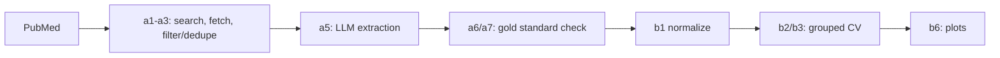

# Trigeminal neuralgia: LLM extraction + ML

> 🚧 **Work in progress.**
>
> **Results: pending real data; current figures are synthetic.** Everything under `track_b_modeling/outputs/` comes from mock data and says nothing about real trigeminal neuralgia.

## Problem

Can the subtype of trigeminal neuralgia (TN) be predicted from clinical features reported in published case reports and series? Subtypes follow the classification of Cruccu et al., *Neurology* 2016;87(2):220-228 (PMID 27306631): `classic`, `idiopathic`, `secondary`. A second task predicts treatment relief (complete / partial / none).

Case reports are found on PubMed, structured with an LLM (Track A), checked against a hand-made gold standard, and then modeled (Track B).

## Pipeline



## Design decisions

- **Clinical-only Q1 vs imaging ablation.** `T1_clinical_only` (age, sex, side, branch, pain type, triggers) is the real question. `T1_with_imaging` adds MRI findings, which *define* the Cruccu subtypes, so it is close to circular; it is kept only as an ablation to show the inflation.
- **`StratifiedGroupKFold` grouped by paper (PMID).** A case series yields several rows per paper; splitting by patient would leak siblings across train and test. Repeated 5x with different seeds.
- **Dummy baselines + shuffled-label sanity check.** `dummy_stratified` and `dummy_most_frequent` appear in every table; models trained on shuffled labels must fall to dummy level, otherwise there is a leak.
- **"not reported" is its own level.** Categorical gaps stay a category; numeric gaps get median + missing indicator.

More detail: `track_a_extraction/README.md`, `track_b_modeling/README.md`.

## How to run

```bash
pip install -r requirements.txt
python tasks.py test      # both offline test suites
python tasks.py model     # b4 on MOCK data, writes track_b_modeling/outputs/
python tasks.py extract   # a1 -> a2 -> a3 -> a5 (needs network + API key, see below)
```

With real data: `python b1_normalize.py extracted_structured.csv`, then `python b4_run_mock.py clean_dataset.csv` (from `track_b_modeling/`). Gold-standard steps (a6/a7) are described in the Track A README.

### API key setup

Keys are read from environment variables only; never commit them (`.env` is git-ignored). PowerShell shown; use `export` on bash.

```powershell
$env:NCBI_EMAIL = "you@example.com"        # a1/a2; the code's default is the placeholder your_email@example.com
$env:LLM_PROVIDERS = "openrouter,groq"     # order to try; "anthropic" also works
$env:OPENROUTER_API_KEY = "..."
$env:OPENROUTER_MODEL   = "..."            # you choose; no default on purpose
$env:GROQ_API_KEY = "..."
$env:GROQ_MODEL   = "..."
```

## Status / to-do

- B6 SHAP: add once n is known; permutation importance is the baseline.
- B7 class imbalance: `class_weight="balanced"` for now. If SMOTE is added, do it inside the CV pipeline, never before splitting.
- Hyperparameter tuning: with a few hundred rows use nested CV or leave defaults and say so.
- Confidence intervals: fold std is reported; add a paper-level bootstrap when the real n is known.
- The outcome definition for T2 is a placeholder (3 levels); decide before the real run.
- Run Track A on the real corpus and the gold-standard check.

## Authors

- **Shahd Osama** ([@ShahdUsama24](https://github.com/ShahdUsama24)) - Track A: data extraction.
- **Abdelrahman El-Sherif** ([@AbdelrahmanEmad253](https://github.com/AbdelrahmanEmad253)) - Track B: modeling and evaluation.

## License

MIT, see [LICENSE](LICENSE).
